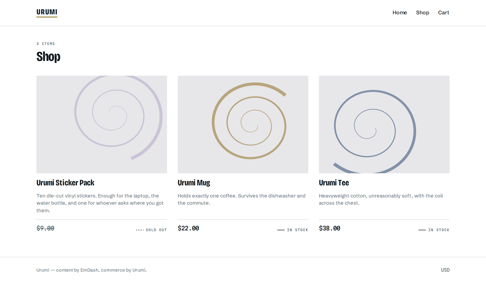

# Otta — an open-source commerce layer for EmDash

[](./LICENSE)
[](https://www.npmjs.com/package/@urumi.ai/otta-plugin)

Open source (MIT). Latest release: `0.2.0` (npm, 2026-11-09), on EmDash `1.3.1`. The
WooCommerce-equivalent for [EmDash](https://github.com/emdash-cms/emdash), Cloudflare's
TypeScript CMS.

[](https://deploy.workers.cloudflare.com/?url=https://github.com/UrumiAI/otta-store-template)

> [!WARNING]
> **In active development — pre-1.0.** The buy flow — catalog, cart, card checkout and cash on
> delivery — works today, but APIs, storage document shapes, settings and admin screens may still
> change between releases. Pin exact versions (`pnpm add -E`) if you build on the packages.



<sub>The reference storefront running locally, with prices and stock served in-process by the
Otta plugin — this is what the [quick start](#quick-start-local-2-minutes) below gives you.</sub>

## Deploy your own store (one click)

The button above copies the public
[store template](https://github.com/UrumiAI/otta-store-template) into your GitHub account and
deploys it to your Cloudflare account as one Worker. It works on **Workers Free** (R2 still needs
a payment method on the Cloudflare account). It creates the D1 database, the two R2 buckets (public
media, private downloads), the KV namespace for admin sessions, the image binding, two rate limits
and an every-minute cron, and asks for one secret, `EMDASH_ENCRYPTION_KEY` (make one with
`npx emdash secrets generate` and keep a copy: it encrypts the payment keys you save in the admin).

The template holds no store code: it depends on `@urumi.ai/otta-store`. Its deploy step
(`npm run deploy`) applies any pending database migrations before the Worker goes live, so a new
store never starts on an unmigrated database. Updates arrive as Dependabot pull requests, and
**merging one deploys it to production**; a release that moves EmDash, Astro or React needs a
manual step instead ([`UPGRADING.md`](./UPGRADING.md)).

The template's README, section "After deploying", is the full checklist (plan limits, failure
recovery, updates, email). In short:

1. **Turn off preview builds first.** Workers Builds also builds other branches, such as the
   weekly update branch, and a version it uploads could run against your live database. In the
   Cloudflare dashboard: your Worker → **Settings** → **Build** → **Branch control** → clear
   **Enable Preview Builds**.
2. **Claim the store, promptly.** It is locked until claimed. Visit `/_emdash/admin` once, then
   find the `[otta-setup]` line in the Worker's logs: it holds the setup link. Until you use it,
   anyone who can read those logs can, and it does not expire. To keep the link out of the logs,
   set a secret `OTTA_SETUP_TOKEN` (32 or more random characters) before the first visit and open
   `/_emdash/admin/setup?setup_token=<token>`. In the wizard, choose **Sample content** for three
   demo products, then create your account and its passkey
   ([ADR-0042](./adr/0042-setup-token-gates-the-first-admin-claim.md)).
3. **Price the products.** Open each product in the admin and fill in its **Pricing & stock**
   cards. A sample product's card says "Product not found" until the product has a commerce
   record: make any small edit and click **Publish changes**, which creates it at once. (A
   background sweep also creates it, but on Workers Free that can take up to a day.)
4. **Take payments.** For cards, first add a webhook endpoint in the Stripe Dashboard for
   `https://<your-site>/webhooks/stripe`, subscribed to exactly `payment_intent.succeeded` and
   `payment_intent.payment_failed`; then, in **Store settings**, enter the publishable key, the
   secret key and that endpoint's signing secret. Or turn on cash on delivery, which needs no
   provider.

[`DEPLOYMENT.md`](./DEPLOYMENT.md) §2.6 describes how the template is built.

## What this is

Otta turns an EmDash site into a store. It is **one deployable**, and it ships as two parts:

1. **Otta plugin** — a sandbox-clean EmDash plugin that owns all money and stock truth
   **in-process**: catalog, inventory, cart, checkout, orders, customers, payments, tax,
   shipping, discounts, entitlements, reporting, and webhooks, plus storefront routes,
   content-sync hooks and an admin console (pricing & inventory, orders, coupons, tax,
   shipping, reports, settings). Commerce state lives in
   the host's per-plugin document store (`ctx.storage`) via the `@urumi.ai/otta-store-emdash`
   adapter — no separate service, no second database. Its only outbound egress is
   `ctx.http.fetch`, gated by `network:request` + `allowedHosts`. The CMS owns content; every commercial
   field lives in the plugin's store and is edited in the admin console
   ([ADR-0018](./adr/0018-plugin-owns-commerce-truth-in-process.md),
   [ADR-0020](./adr/0020-one-deployable-plugin-owns-commerce-truth.md)).
2. **The reference site** (`sites/staging`) — a default EmDash site with the plugin already
   registered, so there's something to actually run. Its store code is the
   `@urumi.ai/otta-store` package (`sites/store`), an Astro integration the site's config
   calls as `otta({ template: 1 })`. It's the storefront in the screenshot
   above and what the [quick start](#quick-start-local-2-minutes) boots: product listing
   pages, cart, and the admin console. Treat it as the worked example to copy from when
   wiring Otta into your own site — it covers catalog, cart, card checkout and customer
   accounts (magic-link sign-in, order history) and paid digital downloads.

## Quick start (local, ~2 minutes)

A full store on your laptop — no Cloudflare account, no deploy, no database to run. The
site's D1 content database and R2 media bucket are emulated locally by the Astro Cloudflare
adapter, and commerce runs **in-process** inside the same worker (the plugin owns cart,
order and inventory state in EmDash plugin storage), so there is no separate service and
no Postgres in the loop.

```bash
pnpm install

# 1. A dev-only encryption key in sites/staging/.dev.vars (gitignored). Without it no
#    payment key can be saved in Settings (ADR-0037). Re-running keeps the key you have.
#    Keep every local secret in this ONE file: once a .dev.vars exists, the dev Worker
#    no longer reads sites/staging/.env, so a key left there is silently ignored.
pnpm --filter @urumi.ai/otta-site-staging exec emdash secrets generate --write .dev.vars

# 2. Storefront + admin.
pnpm --filter @urumi.ai/otta-site-staging dev
```

A fresh store is **locked until it is claimed** with its one-time setup token
([ADR-0042](./adr/0042-setup-token-gates-the-first-admin-claim.md)), locally too: without it,
every `/_emdash` URL (the bypass below included) answers 403. Claim it first, either way:

- open the link the dev server prints on the first `/_emdash` request, a console line
  starting `[otta-setup]` (`http://localhost:4321/_emdash/admin/setup?setup_token=…`); or
- add the token to the same `sites/staging/.dev.vars` as the key from step 1, before
  starting the server
  (`echo "OTTA_SETUP_TOKEN=$(openssl rand -hex 32)" >> sites/staging/.dev.vars`), then open
  `http://localhost:4321/_emdash/admin/setup?setup_token=<that value>`.

The link sets a cookie in your browser and opens the setup wizard. You don't have to finish
the wizard: in the same browser, open the dev-only setup bypass, which claims the site and
applies the full seed including three sample products:

```
http://localhost:4321/_emdash/api/setup/dev-bypass?redirect=/_emdash/admin
```

The seed creates the three sample products as CMS **content** only — prices and stock are
commerce fields it does not touch — so give them some:

```bash
# 3. Price, stock and activate the demo products (second terminal).
#    It reads the products' real ids from the CMS (matching the seed's slugs),
#    then prices and stocks each one through the SITE's own admin API — the same
#    route the product editor's Pricing & stock section uses, so the site URL is all it needs.
SITE_URL=http://localhost:4321 \
  pnpm dlx tsx@4 sites/store/scripts/seed-demo-commerce.ts
```

`/products` now renders a priced catalog and add-to-cart takes a real inventory hold. In the
admin, **Content › Products** lists each product's price and stock; open a product and use its
**Pricing & stock** cards (under the images) to reprice, restock, or price a product of your own.
They are the only place commercial fields are edited; the CMS owns the title, description and images.

One thing to know: card checkout needs Stripe configured: the secret key, webhook signing secret
and publishable key, all in admin Settings. Locally, Stripe's webhooks reach the site only through
`stripe listen`; see [Test card payments locally](./sites/staging/README.md#test-card-payments-locally). A Digital product's file is attached in the same editor
(the **Download file** card) and needs a private `DOWNLOADS` bucket, which local dev
simulates — see [Status](#status).

To deploy your own store, use the [Deploy button](#deploy-your-own-store-one-click); to
self-deploy this repository's reference site instead, follow [`DEPLOYMENT.md`](./DEPLOYMENT.md) §2.

## Try it in the playground

`https://try.otta.sh/playground` is a disposable store: EmDash's per-visitor
playground, with the Otta plugin already installed and the three sample
products priced, in stock, and photographed. Opening it signs you in as the
admin of that copy and lands on the shop at `/products`. The EmDash admin,
including Otta's pricing, inventory and orders screens, stays at
`/_emdash/admin`, linked from the note on each page. The copy lasts about an hour.

Card payments are not connected there, so checkout will not charge a card.
Sign-in email is not sent. Pay-per-crawl, MCP and x402 are not part of this
sandbox. It is not a deploy of your own store — for that, use the
[Deploy button](#deploy-your-own-store-one-click).

Run the same playground locally:

```bash
pnpm --filter @urumi.ai/otta-site-staging dev:playground
```

Then open `http://localhost:4321/playground`. Deploying it is
[`DEPLOYMENT.md`](./DEPLOYMENT.md) §7. The hostname has to be attached by
someone who can add `try.otta.sh` to the Cloudflare account that owns the
`otta.sh` zone.

## Install from npm

Eight packages are published to npm under `@urumi.ai/otta-*`, ESM-only, at `0.2.0`, which needs
EmDash `1.3.1` (the plugin accepts `^1.3.1`; `@urumi.ai/otta-store` pins it exactly).
`@urumi.ai/otta-plugin@0.1.0` is deprecated (its bundle included build environment values): use
`0.2.0`. The other packages' `0.1.0` releases are not affected.

The simplest way to use them is a whole store: `@urumi.ai/otta-store` is the storefront and admin as
one Astro integration (`otta({ template: 1 })`), and is what the one-click template depends on. It
has exact peer pins (EmDash, Astro, React, the Cloudflare adapter and the other Otta packages), so
start from the template's `package.json` (see [its README](./sites/store/README.md)). To add Otta to an EmDash site you already have, install what
the site registers:

```bash
pnpm add @urumi.ai/otta-plugin @urumi.ai/otta-admin-react
```

`@urumi.ai/otta-plugin` brings `@urumi.ai/otta-domain`, `@urumi.ai/otta-store-emdash`, `@urumi.ai/otta-payments-stripe`,
`@urumi.ai/otta-payments-cod` and `@urumi.ai/otta-admin-presentation` with it. The packages export no ready-made plugin descriptor: each
site writes its own. The reference site's are the worked example:
[`otta-plugin-descriptor.ts`](./sites/store/src/otta-plugin-descriptor.ts) and
[`otta-console-descriptor.ts`](./sites/store/src/otta-console-descriptor.ts). Your `otta`
descriptor **must** declare `settingsSchema: { ...PAYMENT_SECRET_SETTINGS_SCHEMA }` (exported by
`@urumi.ai/otta-plugin`) and the host must set `EMDASH_ENCRYPTION_KEY`; without the schema the Stripe
keys are stored as plain text and the plugin cannot tell ([ADR-0037](./adr/0037-payment-secrets-are-encrypted-at-rest.md),
[`DEPLOYMENT.md`](./DEPLOYMENT.md) §3). Each package has
its own README under [`packages/`](./packages/). The workspace, not npm, is how you develop Otta
itself.

Every EmDash release from `1.0.1` through `1.3.1` (`emdash`, `@emdash-cms/auth` and
`@emdash-cms/plugin-types`) pins `zod` at exactly `4.5.4`, which has a known advisory
([GHSA-mrhx-c7xc-m3w5](https://github.com/advisories/GHSA-mrhx-c7xc-m3w5)), so this applies to
every Otta release so far. The Otta packages don't pull in `zod` themselves, but until EmDash pins
`zod` at `4.6.6` or later, a site on pnpm can override it the way this repo does (in
`pnpm-workspace.yaml`; pnpm 11 ignores `pnpm.overrides` in `package.json`):

```yaml
overrides:
  "zod@>=4.0.0 <4.6.6": 4.6.6
```

On npm the same range-keyed pin goes under `overrides` in `package.json`; if the site also depends
on `zod` directly, raise that to `^4.6.6` first, or npm refuses the override with `EOVERRIDE`.
Yarn's `resolutions` silently ignores a range key, so name the pinned version instead:
`"zod@npm:4.5.4": "4.6.6"` on Yarn 2+, or `"zod": "4.6.6"` on Yarn 1 (which forces every `zod` in
the tree).

## Architecture (summary)

- **Product model = hybrid.** Content (title, description, images, SEO, taxonomies)
  lives in a native EmDash `products` collection; commercial data (price, SKU, stock,
  tax, shipping) lives in the plugin's own document store. Link key = the CMS content `id`.
- **One database.** Commerce truth and CMS content share the site's single D1 database:
  content lives in the CMS's own tables, commerce lives in the host's per-plugin document
  store (`ctx.storage`), namespaced by plugin id and collection. They are not joined in
  SQL — the hybrid product model is joined in app code at render time.
- **Ports and adapters.** `@urumi.ai/otta-domain` is pure (no IO); the stores that implement its
  ports live in `@urumi.ai/otta-store-emdash`, which writes one document per aggregate to the
  host's per-plugin document store (`ctx.storage`) by compare-and-set — D1 in dev and in
  production, with a dialect harness that runs the same adapters against SQLite and
  Postgres in CI. The plugin composes those stores in-process, and the domain's contract
  suites are the spec they are held to ([ADR-0019](./adr/0019-commerce-aggregates-are-one-document-each.md)).
- **Pluggable payments.** Stripe (async webhook) behind one `PaymentGateway` interface,
  the seam a further gateway slots into, and cash on delivery as an offline payment method
  that needs no provider ([ADR-0044](./adr/0044-cash-on-delivery-is-an-offline-payment-method.md)).
- **Deployment.** One Worker and one D1 database: the EmDash site with the plugin
  registered trusted (in-process), on the Cloudflare Workers **free** plan, with an
  every-minute cron sweep (expiries, order email and housekeeping, within a per-tick query
  budget; [`DEPLOYMENT.md`](./DEPLOYMENT.md) §5). The plugin still passes the full workerd sandbox
  suite on every CI run, which is the binding contract (ADR-0006).
  Step-by-step bootstrap guide: [`DEPLOYMENT.md`](./DEPLOYMENT.md).

## Repository layout

| Package | What it is |
|---|---|
| `@urumi.ai/otta-domain` | Pure ports, use-cases, branded money types, contract-test suites. No IO. |
| `@urumi.ai/otta-store-emdash` | Store adapters over the host's per-plugin document store — one document per aggregate, compare-and-set writes. |
| `@urumi.ai/otta-payments-stripe` | Stripe `PaymentGateway` adapter (async-webhook, raw-body HMAC). |
| `@urumi.ai/otta-payments-cod` | Cash on delivery: the offline payment method, no provider ([ADR-0044](./adr/0044-cash-on-delivery-is-an-offline-payment-method.md)). |
| `@urumi.ai/otta-plugin` | The EmDash plugin: commerce composition, storefront routes, admin console, content-sync hooks. |
| `@urumi.ai/otta-admin-presentation` | Pure admin presentation primitives (money, dates, short ids, status vocabulary) shared by both console surfaces. No IO. |
| `@urumi.ai/otta-admin-react` | The React admin console on the `otta-console` native descriptor (ADR-0014) — the Orders page, plus the product editor's Pricing & stock cards (and the Download file card for a digital product) and the products list's Price / Stock columns. |
| `@urumi.ai/otta-store` (`sites/store`) | The storefront and admin as one Astro integration, `otta()`: routes, middleware, theme, fonts and build guards (ADR-0045). What the one-click template depends on. |
| `sites/staging` | Not published. The reference site built from `otta()` — EmDash on Cloudflare Workers, plugin registered trusted — plus the e2e suite and the playground config. |
| `examples/email-provider` | Template for an EmDash email-transport plugin (not published); see [`docs/email-providers.md`](./docs/email-providers.md). |

Design decisions live in [`adr/`](./adr/); development practices in
[`DEVELOPMENT.md`](./DEVELOPMENT.md); the agent-facing contract in [`CLAUDE.md`](./CLAUDE.md).

## Development

pnpm workspace · tsdown builds · vitest tests · oxfmt (tabs) · oxlint (type-aware) ·
strict TypeScript.

```bash
pnpm lint         # oxlint + domain-purity dependency check
pnpm typecheck    # tsc -b + e2e + each package's typecheck (site: astro check)
pnpm test         # vitest (better-sqlite3 by default)
pnpm format       # oxfmt, tabs (CI runs pnpm format:check)
```

Heavier tiers: `pnpm test:pg` (Postgres; CI runs it on every PR that changes code),
`pnpm test:d1` (real D1 in workerd), `pnpm test:e2e` and `pnpm test:e2e:claim` (Playwright against
the staging site; CI runs these and `test:d1` on PRs into `main`), and `pnpm test:pack-build`
(builds the one-click template from the packed packages; CI runs it on PRs that touch the
packages).

The **concurrency tests are Postgres-required** — better-sqlite3 serializes writes in one
process, so it verifies the SQL is correct, not that it's race-safe under contention. See
`DEVELOPMENT.md` for the TDD / contract-first workflow and commerce invariants.

## Status

**In active development, pre-1.0.** The latest release is `0.2.0` on npm; expect breaking changes
before 1.0. How a store made from the template takes updates, and what a release that moves
EmDash, Astro or React needs, is in [`UPGRADING.md`](./UPGRADING.md).

**Deploying:** the one-click template is live; a deploy with the button on Workers Free was run
end to end on 2026-11-10 (deploy, storefront, claim). Self-deploying the reference site is [`DEPLOYMENT.md`](./DEPLOYMENT.md) §2.

The commerce **layer** is feature-complete (Phases 0–7 merged): catalog, inventory,
cart, checkout, orders, customers with magic-link auth, Stripe payments, cash on delivery, tax,
shipping, discounts, entitlements, reporting, and settings. `0.2.0` added the setup token
([ADR-0042](./adr/0042-setup-token-gates-the-first-admin-claim.md)), cash on delivery
([ADR-0044](./adr/0044-cash-on-delivery-is-an-offline-payment-method.md)), Cloudflare Email
Sending as the default email provider when a sender is set (Workers Paid;
[ADR-0043](./adr/0043-site-default-cloudflare-email-provider.md)), per-IP rate limits
([`DEPLOYMENT.md`](./DEPLOYMENT.md) §2.5) and the store as one package
([ADR-0045](./adr/0045-the-store-ships-as-an-astro-integration-for-one-click-deploy.md)).
Without an email provider, order emails wait up to 72 hours and are then skipped, and sign-in
links are not sent.

The magic-link email is sent once an EmDash email provider is selected
([`docs/email-providers.md`](./docs/email-providers.md)) and the Settings "Sign-in page address"
(`settings:loginLinkUrl`) points at the storefront's `/account/verify` page.

The reference **storefront** (`sites/staging`) covers catalog, cart, **card checkout**, **cash on
delivery** and **customer accounts** (`/account/login`, `/account/verify`, `/account/orders`):
`/checkout`, the Stripe pay page and the order confirmation page are built
([ADR-0012](./adr/0012-storefront-checkout-loads-stripe-elements-in-the-browser.md)), so a
Stripe-configured deployment completes a card purchase end-to-end
([`DEPLOYMENT.md`](./DEPLOYMENT.md) §3). **Digital downloads** are built (issue #376): the
merchant attaches a file to a Digital product in the product editor, it is stored in a private
R2 bucket, and a buyer downloads it from the order page, re-authorized on every request and
closed by a full refund ([`DEPLOYMENT.md`](./DEPLOYMENT.md) §2.1).

**Known limitations** (open issues):

- Payment methods that confirm days later (SEPA Direct Debit, ACH, Bacs, bank transfer) end in an
  expired order and an automatic refund ([#606](https://github.com/UrumiAI/otta.sh/issues/606)).
  Until that is fixed, turn those methods off in the Stripe Dashboard's payment method settings.
- Dropping or re-adding many sized variants that have SKUs in one save costs two to three database
  queries per variant, so on Workers Free it fails past about 16 to 20 variants
  ([#637](https://github.com/UrumiAI/otta.sh/issues/637)).

## License

MIT
